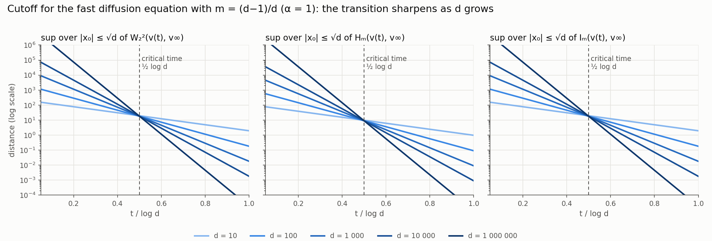
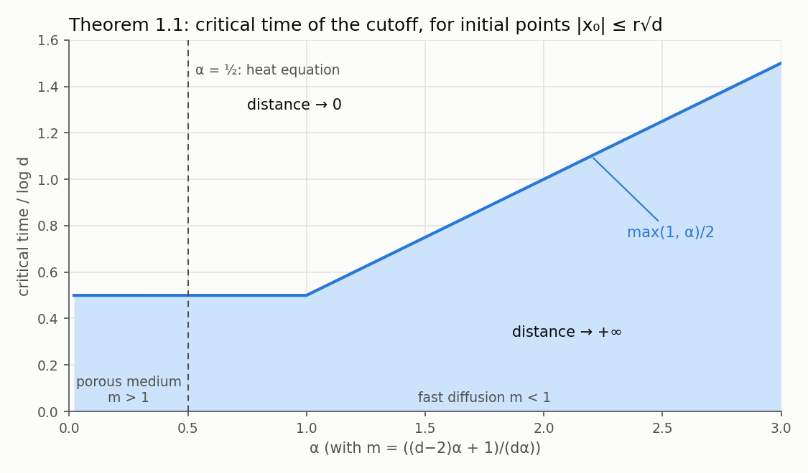

# Cutfast: cutoff for fast diffusion and porous medium equations in Lean

[](https://github.com/djalilchafai/cutoff-fastdiff/actions/workflows/ci.yml)
[](https://djalilchafai.github.io/cutoff-fastdiff/Cutfast.html)
[](LICENSE)
[](https://arxiv.org/abs/2503.11770)
[](lean-toolchain)
[](https://github.com/leanprover-community/mathlib4/tree/065356127b1dc0016f66b7283ce0ce2c4055aa55)
[](https://palomar-registry.org/)

A Lean 4 / Mathlib formalization, in the [Palomar](https://palomar-registry.org/) format, of

> D. Chafaï, M. Fathi, N. Simonov, *On the cutoff phenomenon for fast diffusion and porous
> medium equations*, [arXiv:2503.11770](https://arxiv.org/abs/2503.11770) (source: `cutfast-lean.tex`).

For `∂ₜv = Δ(vᵐ) + div(xv)` in `ℝᵈ` started from `δ_{x₀}`, whose solution is an explicit rescaled
Barenblatt profile, the quadratic Wasserstein distance `W₂²`, the relative entropy `Hₘ` and the
Fisher information `Iₘ` to equilibrium, maximized over `|x₀| ≤ r√d`, jump from `+∞` to `0` as
`d → ∞` at time `max(1,α)/2 · log d` (fixed `α ≠ 1/2`, Theorem 1.1) or `1/2 · log d` (fixed
`m > 1`, Theorem 1.2).



The curves are the exact formulas proved in Lean (`Cutfast/Distances.lean`), evaluated with the
exact second moment of Lemma 3.1. The critical time depends on `α` as follows:



`docs/dependencies.md` shows which results each proof uses, read from the compiled proofs, and
how the Lean modules import each other.

The API documentation of the Lean development is at
https://djalilchafai.github.io/cutoff-fastdiff/Cutfast.html (rebuilt on demand by the `docs`
job of CI; links to Mathlib and Lean go to their official documentation).

## Repository map

- `Challenge.lean` — the trusted statement surface (definitions with docstrings and every
  advertised theorem, with `sorry`). This is what a reader audits.
- `FORMALIZATION_GUIDE.md` — for each statement of the paper: where it is formalized, how it is
  stated in Lean, and how it is proved. Start here.
- `docs/` — `dependencies.md` (statement dependency graph and module import graph, generated by
  `scripts/gen-graphs.py` after `lake build`) and the figures above (generated by
  `scripts/plot-cutoff.py`).
- `scripts/count-lines.py` — the line counts of the Size section below and of the guide.
- `scripts/prune-docs.py` — trims the doc-gen4 output to the Cutfast pages for GitHub Pages.
- `Solution.lean` — proves each Challenge theorem `T` by the development lemma `T'`
  (generated by `scripts/gen-solution.py`).
- `Cutfast/Defs.lean` — the Challenge definitions, generated verbatim by `scripts/sync-defs.py`.
- Proof development:
  - `Cutfast/Radial.lean` — polar coordinates and Euler Beta integrals for
    `∫ |x|ᵃ (C ± β|x|²)^{∓p}`;
  - `Cutfast/Moments.lean` — exact formulas of Lemmas 3.1 and 4.1, virial identity
    `∫|x|²B = d∫Bᵐ`;
  - `Cutfast/Asymptotics.lean` — a Stirling estimate for `log Γ` and Lemmas 3.1, 4.1, 4.2
    asymptotics;
  - `Cutfast/Barenblatt.lean` — normalization, equilibrium, `v(t)` as an affine image of `v_∞`;
  - `Cutfast/Wasserstein.lean` — Lemma 2.1 (elementary Fenchel–Young proof, no Brenier);
  - `Cutfast/Elliptic.lean` — Lemma 2.2 (matrix square roots via `CFC.sqrt`);
  - `Cutfast/Distances.lean` — exact formulas for `W₂²`, `Hₘ`, `Iₘ` along the flow;
  - `Cutfast/PDE.lean` — the explicit solution solves the equation;
  - `Cutfast/FDE.lean` — the solution `u` of `∂ₜu = Δ(uᵐ)`, the time change, initial and
    long-time behavior;
  - `Cutfast/HeavyTail.lean` — second moment iff `m > d/(d+2)`, and `W₂² = ∞` otherwise;
  - `Cutfast/Entropy.lean` — entropy dissipation `dHₘ/dt = −Iₘ`, Bregman form, Tsallis limit;
  - `Cutfast/DiffusionLimit.lean` — the limit `m → 1` (Gaussian, heat kernel, Mehler);
  - `Cutfast/Cutoff.lean` — Theorems 1.1 and 1.2;
  - `Cutfast/CutoffRadius.lean` — cutoff for initial points in balls of radius `r d^θ`
    (Section 1.4.3);
  - `Cutfast/Student.lean` — Remark 3.2 (Student t-distributions);
  - `Cutfast/Sphere.lean` — Remark 4.3 (projections of uniform laws on spheres).
- `ERRATA.md` — mathematical errors in the paper found during the formalization, and their
  fixes (applied to `cutfast-lean.tex` in this directory).
- `comparator.json`, `formalization.yaml` (scope, divergences from the paper, provenance,
  AI use), `LICENSE` (Apache-2.0).

## Size

<!-- lines:begin -->
| | Lines |
|---|---:|
| `Cutfast/*.lean` | 8,119 |
| `Challenge.lean` | 708 |
| `Solution.lean` | 589 |
| **This formalization** | **9,416** |
| Mathlib, whole library (8,536 files, all imported) | 2,330,053 |
| **Mathlib, used by the proofs** (40,060 declarations in 1,970 files) | **180,440** |

"Used" counts the source lines of the Mathlib declarations reached from the 49 theorems through statements and proofs, instances included. Not counted: 19,659 auto-generated Mathlib declarations, and 24,537 lines of Lean's core library. Generated by `scripts/count-lines.py`.
<!-- lines:end -->

## Checks

```text
python3 scripts/check-lean-sources.py
python3 scripts/sync-defs.py --check && python3 scripts/gen-solution.py --check
lake build
ruby scripts/validate-formalization.rb
./scripts/verify-comparator.sh
```

`lake comparator` sandboxes with `bwrap`, which cannot mount over a symlinked `.lake`: run it in a
checkout whose `.lake` is a real directory.

Submissions go through the form at https://submit.palomar-registry.org/ (see the
[Palomar policy](https://github.com/PalomarRegistry/PalomarPolicy/blob/main/CONTRIBUTING.md));
Palomar expects the Lean project at the repository root.

## Citation

GitHub's "Cite this repository" button uses `CITATION.cff`.

To cite the paper:

```bibtex
@misc{ChafaiFathiSimonov2025,
  author        = {Chafa{\"\i}, Djalil and Fathi, Max and Simonov, Nikita},
  title         = {On the cutoff phenomenon for fast diffusion and porous medium equations},
  year          = {2025},
  eprint        = {2503.11770},
  archivePrefix = {arXiv},
  primaryClass  = {math.AP},
  url           = {https://arxiv.org/abs/2503.11770}
}
```

To cite this formalization:

```bibtex
@software{Chafai2026Cutfast,
  author = {Chafa{\"\i}, Djalil},
  title  = {Cutfast: a {Lean} 4 / {Mathlib} formalization of the cutoff phenomenon for fast
            diffusion and porous medium equations},
  year   = {2026},
  url    = {https://github.com/djalilchafai/cutoff-fastdiff}
}
```
