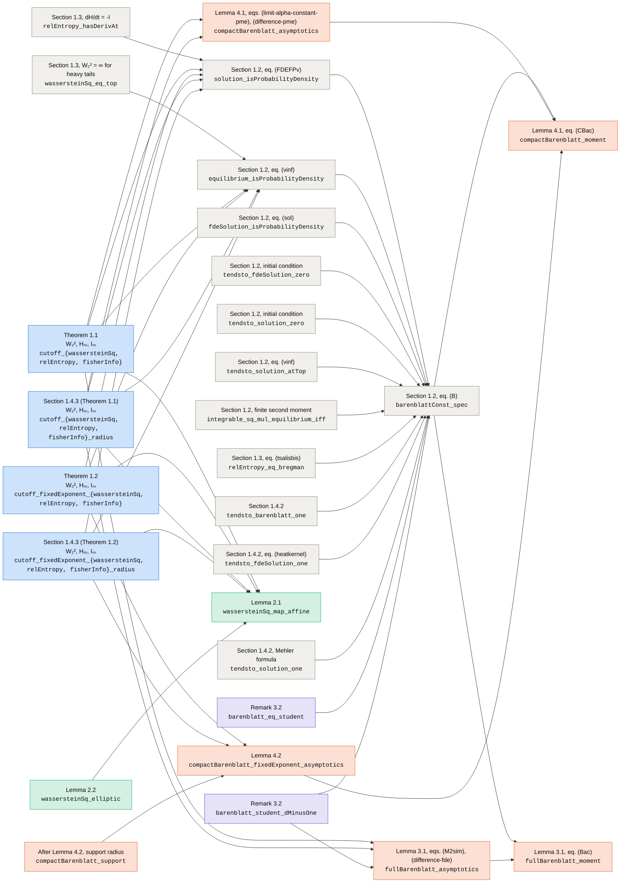
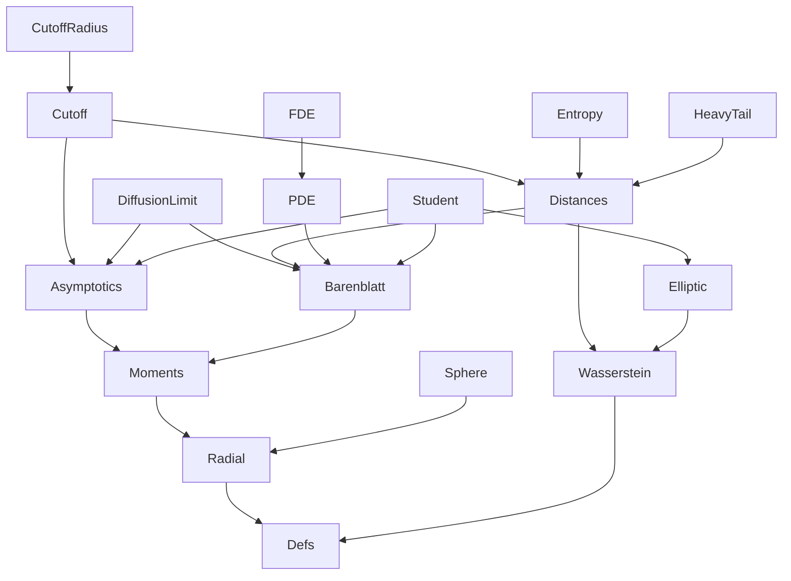

# Dependency graphs

Generated by `scripts/gen-graphs.py` from the compiled proofs; do not edit by hand.

## Which results each proof uses

An arrow `A → B` means that the Lean proof of `A` uses the statement `B`, directly or through
intermediate lemmas of the development (Mathlib is not followed). Arrows implied by others are
omitted. A statement without outgoing arrows is proved from Mathlib and the development's own
lemmas only. See `FORMALIZATION_GUIDE.md` for each statement.

Colors: Sections 1.2–1.4.2 (gray) · Theorems 1.1, 1.2 and Section 1.4.3 (blue) · Lemmas 2.1, 2.2 (green) · Lemmas 3.1, 4.1, 4.2 (orange) · Remarks 3.2, 4.3 (violet).

Not drawn: 13 statements whose proofs use no other advertised statement and are used by none: [`solution_hasDerivAt`](https://djalilchafai.github.io/cutoff-fastdiff/Cutfast/PDE.html#Cutfast.solution_hasDerivAt'), [`fdeSolution_hasDerivAt`](https://djalilchafai.github.io/cutoff-fastdiff/Cutfast/FDE.html#Cutfast.fdeSolution_hasDerivAt'), [`solution_eq_fdeSolution`](https://djalilchafai.github.io/cutoff-fastdiff/Cutfast/FDE.html#Cutfast.solution_eq_fdeSolution'), [`tsallis_strictConvexOn_tendsto_log`](https://djalilchafai.github.io/cutoff-fastdiff/Cutfast/Entropy.html#Cutfast.tsallis_strictConvexOn_tendsto_log'), [`fullBarenblatt_integral_rpow`](https://djalilchafai.github.io/cutoff-fastdiff/Cutfast/Moments.html#Cutfast.fullBarenblatt_integral_rpow'), [`compactBarenblatt_integral_rpow`](https://djalilchafai.github.io/cutoff-fastdiff/Cutfast/Moments.html#Cutfast.compactBarenblatt_integral_rpow'), [`student_law`](https://djalilchafai.github.io/cutoff-fastdiff/Cutfast/Student.html#Cutfast.student_law'), [`student_moments`](https://djalilchafai.github.io/cutoff-fastdiff/Cutfast/Student.html#Cutfast.student_moments'), [`tendsto_student_gaussian`](https://djalilchafai.github.io/cutoff-fastdiff/Cutfast/Student.html#Cutfast.tendsto_student_gaussian'), [`student_fisherSnedecor`](https://djalilchafai.github.io/cutoff-fastdiff/Cutfast/Student.html#Cutfast.student_fisherSnedecor'), [`sphereUniform_map_projFirst`](https://djalilchafai.github.io/cutoff-fastdiff/Cutfast/Sphere.html#Cutfast.sphereUniform_map_projFirst'), [`stdGaussian_map_sphereUniform`](https://djalilchafai.github.io/cutoff-fastdiff/Cutfast/Sphere.html#Cutfast.stdGaussian_map_sphereUniform'), [`sphereUniform_map_stereoProj`](https://djalilchafai.github.io/cutoff-fastdiff/Cutfast/Sphere.html#Cutfast.sphereUniform_map_stereoProj').

## Module imports

`A → B` means that `Cutfast/A.lean` imports `Cutfast/B.lean` (imports implied by others are
omitted). `Defs` holds the definitions of `Challenge.lean`.

API documentation of each module: [Asymptotics](https://djalilchafai.github.io/cutoff-fastdiff/Cutfast/Asymptotics.html), [Barenblatt](https://djalilchafai.github.io/cutoff-fastdiff/Cutfast/Barenblatt.html), [Cutoff](https://djalilchafai.github.io/cutoff-fastdiff/Cutfast/Cutoff.html), [CutoffRadius](https://djalilchafai.github.io/cutoff-fastdiff/Cutfast/CutoffRadius.html), [Defs](https://djalilchafai.github.io/cutoff-fastdiff/Cutfast/Defs.html), [DiffusionLimit](https://djalilchafai.github.io/cutoff-fastdiff/Cutfast/DiffusionLimit.html), [Distances](https://djalilchafai.github.io/cutoff-fastdiff/Cutfast/Distances.html), [Elliptic](https://djalilchafai.github.io/cutoff-fastdiff/Cutfast/Elliptic.html), [Entropy](https://djalilchafai.github.io/cutoff-fastdiff/Cutfast/Entropy.html), [FDE](https://djalilchafai.github.io/cutoff-fastdiff/Cutfast/FDE.html), [HeavyTail](https://djalilchafai.github.io/cutoff-fastdiff/Cutfast/HeavyTail.html), [Moments](https://djalilchafai.github.io/cutoff-fastdiff/Cutfast/Moments.html), [PDE](https://djalilchafai.github.io/cutoff-fastdiff/Cutfast/PDE.html), [Radial](https://djalilchafai.github.io/cutoff-fastdiff/Cutfast/Radial.html), [Sphere](https://djalilchafai.github.io/cutoff-fastdiff/Cutfast/Sphere.html), [Student](https://djalilchafai.github.io/cutoff-fastdiff/Cutfast/Student.html), [Wasserstein](https://djalilchafai.github.io/cutoff-fastdiff/Cutfast/Wasserstein.html).

## API documentation of each statement

Each statement `T` of `Challenge.lean` is proved by the lemma `T'`, whose API documentation is
linked below.

| Paper | Lean proof (API documentation) |
|---|---|
| Section 1.2, eq. (B) | [`barenblattConst_spec`](https://djalilchafai.github.io/cutoff-fastdiff/Cutfast/Barenblatt.html#Cutfast.barenblattConst_spec') |
| Section 1.2, eq. (FDEFPv) | [`solution_isProbabilityDensity`](https://djalilchafai.github.io/cutoff-fastdiff/Cutfast/Barenblatt.html#Cutfast.solution_isProbabilityDensity') |
| Section 1.2, eq. (vinf) | [`equilibrium_isProbabilityDensity`](https://djalilchafai.github.io/cutoff-fastdiff/Cutfast/Barenblatt.html#Cutfast.equilibrium_isProbabilityDensity') |
| Section 1.2, eq. (FDEFP) | [`solution_hasDerivAt`](https://djalilchafai.github.io/cutoff-fastdiff/Cutfast/PDE.html#Cutfast.solution_hasDerivAt') |
| Section 1.2, eq. (sol) | [`fdeSolution_hasDerivAt`](https://djalilchafai.github.io/cutoff-fastdiff/Cutfast/FDE.html#Cutfast.fdeSolution_hasDerivAt') |
| Section 1.2, eq. (sol) | [`fdeSolution_isProbabilityDensity`](https://djalilchafai.github.io/cutoff-fastdiff/Cutfast/FDE.html#Cutfast.fdeSolution_isProbabilityDensity') |
| Section 1.2, eqs. (uv), (FDEFPv) | [`solution_eq_fdeSolution`](https://djalilchafai.github.io/cutoff-fastdiff/Cutfast/FDE.html#Cutfast.solution_eq_fdeSolution') |
| Section 1.2, initial condition | [`tendsto_fdeSolution_zero`](https://djalilchafai.github.io/cutoff-fastdiff/Cutfast/FDE.html#Cutfast.tendsto_fdeSolution_zero') |
| Section 1.2, initial condition | [`tendsto_solution_zero`](https://djalilchafai.github.io/cutoff-fastdiff/Cutfast/FDE.html#Cutfast.tendsto_solution_zero') |
| Section 1.2, eq. (vinf) | [`tendsto_solution_atTop`](https://djalilchafai.github.io/cutoff-fastdiff/Cutfast/FDE.html#Cutfast.tendsto_solution_atTop') |
| Section 1.2, finite second moment | [`integrable_sq_mul_equilibrium_iff`](https://djalilchafai.github.io/cutoff-fastdiff/Cutfast/HeavyTail.html#Cutfast.integrable_sq_mul_equilibrium_iff') |
| Section 1.3, W₂ infinite for d ≤ 2 | [`wassersteinSq_eq_top`](https://djalilchafai.github.io/cutoff-fastdiff/Cutfast/HeavyTail.html#Cutfast.wassersteinSq_eq_top') |
| Section 1.3, dH/dt = -I | [`relEntropy_hasDerivAt`](https://djalilchafai.github.io/cutoff-fastdiff/Cutfast/Entropy.html#Cutfast.relEntropy_hasDerivAt') |
| Section 1.3, eq. (tsalisbis) | [`relEntropy_eq_bregman`](https://djalilchafai.github.io/cutoff-fastdiff/Cutfast/Entropy.html#Cutfast.relEntropy_eq_bregman') |
| Section 1.3, Tsallis function | [`tsallis_strictConvexOn_tendsto_log`](https://djalilchafai.github.io/cutoff-fastdiff/Cutfast/Entropy.html#Cutfast.tsallis_strictConvexOn_tendsto_log') |
| Section 1.4.2 | [`tendsto_barenblatt_one`](https://djalilchafai.github.io/cutoff-fastdiff/Cutfast/DiffusionLimit.html#Cutfast.tendsto_barenblatt_one') |
| Section 1.4.2, eq. (heatkernel) | [`tendsto_fdeSolution_one`](https://djalilchafai.github.io/cutoff-fastdiff/Cutfast/DiffusionLimit.html#Cutfast.tendsto_fdeSolution_one') |
| Section 1.4.2, Mehler formula | [`tendsto_solution_one`](https://djalilchafai.github.io/cutoff-fastdiff/Cutfast/DiffusionLimit.html#Cutfast.tendsto_solution_one') |
| Theorem 1.1 | [`cutoff_wassersteinSq`](https://djalilchafai.github.io/cutoff-fastdiff/Cutfast/Cutoff.html#Cutfast.cutoff_wassersteinSq') |
| Theorem 1.1 | [`cutoff_relEntropy`](https://djalilchafai.github.io/cutoff-fastdiff/Cutfast/Cutoff.html#Cutfast.cutoff_relEntropy') |
| Theorem 1.1 | [`cutoff_fisherInfo`](https://djalilchafai.github.io/cutoff-fastdiff/Cutfast/Cutoff.html#Cutfast.cutoff_fisherInfo') |
| Theorem 1.2 | [`cutoff_fixedExponent_wassersteinSq`](https://djalilchafai.github.io/cutoff-fastdiff/Cutfast/Cutoff.html#Cutfast.cutoff_fixedExponent_wassersteinSq') |
| Theorem 1.2 | [`cutoff_fixedExponent_relEntropy`](https://djalilchafai.github.io/cutoff-fastdiff/Cutfast/Cutoff.html#Cutfast.cutoff_fixedExponent_relEntropy') |
| Theorem 1.2 | [`cutoff_fixedExponent_fisherInfo`](https://djalilchafai.github.io/cutoff-fastdiff/Cutfast/Cutoff.html#Cutfast.cutoff_fixedExponent_fisherInfo') |
| Section 1.4.3 | [`cutoff_wassersteinSq_radius`](https://djalilchafai.github.io/cutoff-fastdiff/Cutfast/CutoffRadius.html#Cutfast.cutoff_wassersteinSq_radius') |
| Section 1.4.3 | [`cutoff_relEntropy_radius`](https://djalilchafai.github.io/cutoff-fastdiff/Cutfast/CutoffRadius.html#Cutfast.cutoff_relEntropy_radius') |
| Section 1.4.3 | [`cutoff_fisherInfo_radius`](https://djalilchafai.github.io/cutoff-fastdiff/Cutfast/CutoffRadius.html#Cutfast.cutoff_fisherInfo_radius') |
| Section 1.4.3 | [`cutoff_fixedExponent_wassersteinSq_radius`](https://djalilchafai.github.io/cutoff-fastdiff/Cutfast/CutoffRadius.html#Cutfast.cutoff_fixedExponent_wassersteinSq_radius') |
| Section 1.4.3 | [`cutoff_fixedExponent_relEntropy_radius`](https://djalilchafai.github.io/cutoff-fastdiff/Cutfast/CutoffRadius.html#Cutfast.cutoff_fixedExponent_relEntropy_radius') |
| Section 1.4.3 | [`cutoff_fixedExponent_fisherInfo_radius`](https://djalilchafai.github.io/cutoff-fastdiff/Cutfast/CutoffRadius.html#Cutfast.cutoff_fixedExponent_fisherInfo_radius') |
| Lemma 2.1 | [`wassersteinSq_map_affine`](https://djalilchafai.github.io/cutoff-fastdiff/Cutfast/Wasserstein.html#Cutfast.wassersteinSq_map_affine') |
| Lemma 2.2 | [`wassersteinSq_elliptic`](https://djalilchafai.github.io/cutoff-fastdiff/Cutfast/Elliptic.html#Cutfast.wassersteinSq_elliptic') |
| Lemma 3.1, eq. (Bac) | [`fullBarenblatt_moment`](https://djalilchafai.github.io/cutoff-fastdiff/Cutfast/Moments.html#Cutfast.fullBarenblatt_moment') |
| Lemma 3.1, eq. (Bm) | [`fullBarenblatt_integral_rpow`](https://djalilchafai.github.io/cutoff-fastdiff/Cutfast/Moments.html#Cutfast.fullBarenblatt_integral_rpow') |
| Lemma 3.1, eqs. (M2sim), (difference-fde) | [`fullBarenblatt_asymptotics`](https://djalilchafai.github.io/cutoff-fastdiff/Cutfast/Asymptotics.html#Cutfast.fullBarenblatt_asymptotics') |
| Lemma 4.1, eq. (CBac) | [`compactBarenblatt_moment`](https://djalilchafai.github.io/cutoff-fastdiff/Cutfast/Moments.html#Cutfast.compactBarenblatt_moment') |
| Lemma 4.1, eq. (Bmpme) | [`compactBarenblatt_integral_rpow`](https://djalilchafai.github.io/cutoff-fastdiff/Cutfast/Moments.html#Cutfast.compactBarenblatt_integral_rpow') |
| Lemma 4.1, eqs. (limit-alpha-constant-pme), (difference-pme) | [`compactBarenblatt_asymptotics`](https://djalilchafai.github.io/cutoff-fastdiff/Cutfast/Asymptotics.html#Cutfast.compactBarenblatt_asymptotics') |
| Lemma 4.2 | [`compactBarenblatt_fixedExponent_asymptotics`](https://djalilchafai.github.io/cutoff-fastdiff/Cutfast/Asymptotics.html#Cutfast.compactBarenblatt_fixedExponent_asymptotics') |
| After Lemma 4.2, support radius | [`compactBarenblatt_support`](https://djalilchafai.github.io/cutoff-fastdiff/Cutfast/CutoffRadius.html#Cutfast.compactBarenblatt_support') |
| Remark 3.2 | [`student_law`](https://djalilchafai.github.io/cutoff-fastdiff/Cutfast/Student.html#Cutfast.student_law') |
| Remark 3.2 | [`student_moments`](https://djalilchafai.github.io/cutoff-fastdiff/Cutfast/Student.html#Cutfast.student_moments') |
| Remark 3.2 | [`tendsto_student_gaussian`](https://djalilchafai.github.io/cutoff-fastdiff/Cutfast/Student.html#Cutfast.tendsto_student_gaussian') |
| Remark 3.2 | [`student_fisherSnedecor`](https://djalilchafai.github.io/cutoff-fastdiff/Cutfast/Student.html#Cutfast.student_fisherSnedecor') |
| Remark 3.2 | [`barenblatt_eq_student`](https://djalilchafai.github.io/cutoff-fastdiff/Cutfast/Student.html#Cutfast.barenblatt_eq_student') |
| Remark 3.2 | [`barenblatt_student_dMinusOne`](https://djalilchafai.github.io/cutoff-fastdiff/Cutfast/Student.html#Cutfast.barenblatt_student_dMinusOne') |
| Remark 4.3 | [`sphereUniform_map_projFirst`](https://djalilchafai.github.io/cutoff-fastdiff/Cutfast/Sphere.html#Cutfast.sphereUniform_map_projFirst') |
| Remark 4.3 | [`stdGaussian_map_sphereUniform`](https://djalilchafai.github.io/cutoff-fastdiff/Cutfast/Sphere.html#Cutfast.stdGaussian_map_sphereUniform') |
| Remark 4.3 | [`sphereUniform_map_stereoProj`](https://djalilchafai.github.io/cutoff-fastdiff/Cutfast/Sphere.html#Cutfast.sphereUniform_map_stereoProj') |
