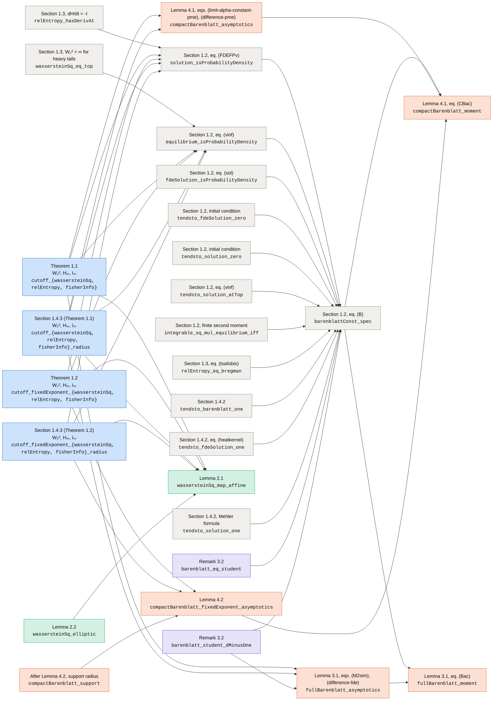
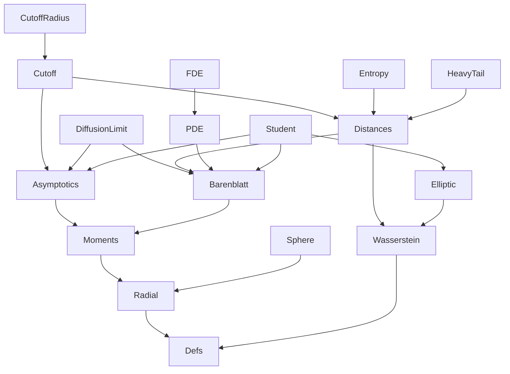

# Dependency graphs

Generated by `scripts/gen-graphs.py` from the compiled proofs; do not edit by hand.

## Which results each proof uses

An arrow `A → B` means that the Lean proof of `A` uses the statement `B`, directly or through
intermediate lemmas of the development (Mathlib is not followed). Arrows implied by others are
omitted. A statement without outgoing arrows is proved from Mathlib and the development's own
lemmas only. See `FORMALIZATION_GUIDE.md` for each statement.

Colors: Sections 1.2–1.4.2 (gray) · Theorems 1.1, 1.2 and Section 1.4.3 (blue) · Lemmas 2.1, 2.2 (green) · Lemmas 3.1, 4.1, 4.2 (orange) · Remarks 3.2, 4.3 (violet).

Not drawn: 13 statements whose proofs use no other advertised statement and are used by none: `solution_hasDerivAt`, `fdeSolution_hasDerivAt`, `solution_eq_fdeSolution`, `tsallis_strictConvexOn_tendsto_log`, `fullBarenblatt_integral_rpow`, `compactBarenblatt_integral_rpow`, `student_law`, `student_moments`, `tendsto_student_gaussian`, `student_fisherSnedecor`, `sphereUniform_map_projFirst`, `stdGaussian_map_sphereUniform`, `sphereUniform_map_stereoProj`.

## Module imports

`A → B` means that `Cutfast/A.lean` imports `Cutfast/B.lean` (imports implied by others are
omitted). `Defs` holds the definitions of `Challenge.lean`.

